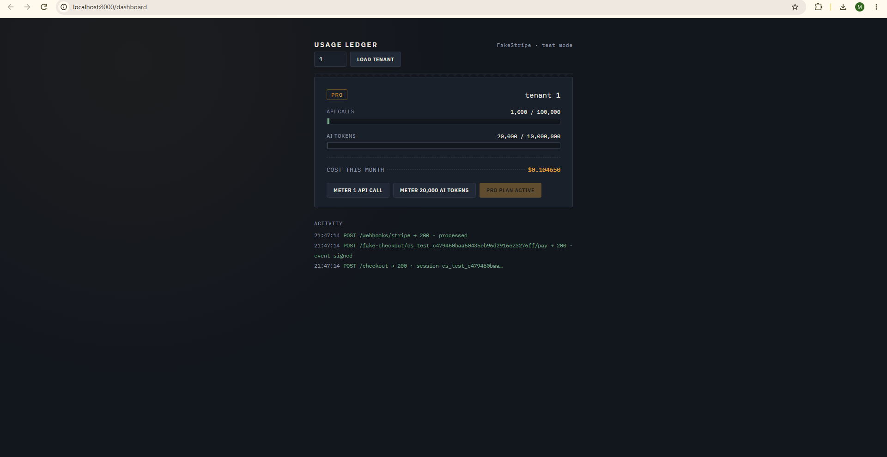

# Usage Metering & Billing Engine

The backend service every SaaS needs: how much has this customer used, what does it cost, and have they hit their limit?

**Core features:**
- Idempotent usage metering — retries never double-count
- Exact quota boundaries — 429/402 with a clear message
- AI-token cost math — cached input, reasoning tokens, pinned pricing constants
- Stripe-test-mode-style subscription sync via signed, deduped webhooks



---

## Architecture

```
Client ──► POST /generate
              └─► MeterService.record(tenant, type, qty, idempotency_key)
                    ├─ duplicate key? → return original result
                    ├─ store usage_event
                    └─► Quota check ─► allowed
                          └─ limit exceeded → 402 / 429 + message

GET /usage ◄── rollup(usage_events) → { used, limit, cost }

FakeStripe Checkout (test mode) ─► subscription created
FakeStripe ─signed webhook─► /webhooks/stripe
   ├─► verify signature (forged → 400)
   ├─► dedupe event (replay → ignored)
   └─► update tenant plan/status
```

**Checkout flow (FakeStripe):**

```
POST /checkout {tenant_id, plan_name}
   → creates a CheckoutSession, returns {id, url}

POST /fake-checkout/{id}/pay          (stands in for Stripe's hosted page)
   → marks the session complete, returns a signed
     checkout.session.completed event (does NOT touch the DB)

POST /webhooks/stripe                 (the real integration point)
   → verifies the signature, dedupes by event id,
     updates Subscription.plan_id/status
```

---

## Setup (clean machine)

```
git clone <repo-url>
cd flyrank-capstone-metering-billing
py -3.11 -m venv venv
venv\Scripts\activate          # Windows
pip install -r requirements.txt
cp .env.example .env           # fill in Stripe test keys
python -m app.seed             # seed a tenant near quota
uvicorn app.main:app --reload
```

- Run tests: `pytest -q`. GitHub Actions runs the same suite on every push and pull request ([`.github/workflows/tests.yml`](.github/workflows/tests.yml)).
- Try the dashboard: `http://localhost:8000/dashboard`
- Run the demo script: `python -m tools.demo` (see `DEMO.md`)
- Replay/trigger webhooks locally (stands in for `stripe listen` / `stripe trigger`):
  `python -m tools.fake_stripe_cli sub_deleted --tenant-id 1`,
  `python -m tools.fake_stripe_cli forge --tenant-id 1 --plan-id 2` (expects 400),
  `python -m tools.fake_stripe_cli replay --tenant-id 1 --plan-id 2` (expects dedup on the 2nd call)

**Example — metering an AI-token call:**

```
curl -X POST http://localhost:8000/generate -H "Content-Type: application/json" -d '{
  "tenant_id": 1,
  "idempotency_key": "unique-per-request",
  "usage_type": "ai_tokens",
  "metadata": {"input_tokens": 50000, "cached_input_tokens": 20000, "output_tokens": 20000, "reasoning_tokens": 10000}
}'
```

Retrying with the same `idempotency_key` returns the identical result (`duplicate: true`) — no second usage event, no double-counted cost.

---

## Limitations

- No proration, invoicing, or overage billing in core scope (see `DESIGN.md` non-goal).
- AI token usage is simulated, not pulled from a real model call.
- **Payment provider — why FakeStripe instead of real Stripe:**
  - Stripe, Paddle, Lemon Squeezy, and Razorpay all require a seller entity registered in a supported country — Pakistan isn't on any of their lists (verified while building this).
  - FakeStripe (`app/fake_stripe.py`) reproduces Stripe's actual webhook contract: HMAC-SHA256 signing over `"<timestamp>.<payload>"`, a `Stripe-Signature`-style header, Stripe-shaped events.
  - Signature verification, replay protection, and dedup are genuinely tested — not faked away.
  - Swapping in real Stripe later only touches `app/fake_stripe.py` and `app/checkout.py`; the webhook handler and data model don't change.

---

## Stretch goal — Usage alerts (§9)

- `GET /usage` includes an `alerts` array.
- "Warning" at ≥80% of a plan's quota, "critical" at 100%.
- Computed independently for API calls and AI tokens (`app/alerts.py`).
- 8 pinned tests, including a regression test for a rounding bug caught while building this: 999/1000 (99.9%) must never round up to a misleading "100%" warning.

---

## Frontend dashboard

- `GET /dashboard` serves a small vanilla-JS/HTML/CSS frontend (`static/dashboard.html`, no build step) over the JSON API.
- Shows live usage meters, the cost rollup, active alerts, and an activity log.
- Buttons exercise the real endpoints: meter an API call, meter a batch of AI tokens, or run the full Checkout → FakeStripe pay → webhook flow to upgrade to Pro.
- It's a demo/visualization layer, not part of the graded core API.

**A real bug this caught:** the browser's Checkout flow initially failed webhook signature verification (400), even though the identical flow worked fine from Python.

- **Cause**: `POST /fake-checkout/{id}/pay` returned the signed event as a *parsed* JSON object. The browser's `JSON.stringify()` re-serializes it with different whitespace than Python's `json.dumps()` used to sign it, so the HMAC no longer matched the re-encoded bytes.
- **Fix**: the endpoint now returns the raw payload string instead, sent verbatim by the client — the same class of bug real Stripe integrations have to get right (always verify against the exact raw delivered body, never a re-encoded copy).
- **Regression test**: `tests/test_webhooks.py::test_reserialized_payload_with_different_whitespace_fails_verification`

---

## Cross-checked against the brief

Re-read the full capstone brief against the actual repo state and found + fixed two real gaps:

- **Negative quantity / negative token counts were silently accepted.** `POST /generate` with `quantity: -500` reduced `used_this_month` below its true value (bypassing quota) and produced a **negative cost** — exactly the "giving away unlimited access, or losing revenue" failure mode the brief warns about. Fixed with `Field(gt=0)` on the request model for `quantity`, and explicit non-negative-integer validation on the `ai_tokens` metadata breakdown. See `tests/test_api_validation.py` (6 tests) and `EVIDENCE.md`.
- **Stale `.env.example` and `capstone.yaml`.** Both still referenced real Stripe keys/API after the FakeStripe swap in Phase 3 — `.env.example` had unused `STRIPE_SECRET_KEY`/`STRIPE_PRICE_ID_PRO` fields the app never reads, and `capstone.yaml` described `/checkout` as a real Stripe session. Both now accurately describe FakeStripe.
- Also documented `tools/fake_stripe_cli.py` in the README — it existed but was never surfaced, and it's the direct stand-in for the brief's "use the Stripe CLI to forward and replay webhooks locally" requirement.

---

## Status

| Phase | What | Status |
|---|---|---|
| 1 | Design doc | ✅ Done |
| 2 | Idempotent metering + quota enforcement | ✅ Done — 11/11 tests |
| 3 | FakeStripe checkout + signed/deduped webhooks | ✅ Done — 21/21 tests |
| 4 | Cost rollups + AI-token pricing rules | ✅ Done — 31/31 tests |
| 5 | Demo prep (see `DEMO.md`) | ✅ Done |
| Stretch | Usage alerts + frontend dashboard | ✅ Done — 40/40 tests |
| Cross-check | Re-verified against the full brief — found + fixed a negative-quantity billing bug and stale docs | ✅ Done — 46/46 tests |

Core Definition of Done (§6) is complete. See `DESIGN.md` and `EVIDENCE.md` for full detail.
